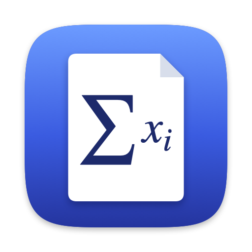

# mathpdf

I couldn't find an app that satisfied me that could incorporate LaTeX
annotations, so I decided I had to vibecode a new one. Additionally, I became
tired of having the Mac Preview app lose all my annotations on papers and
lecture notes, so I made sure this one is robust.

If you have any suggestions on how to improve the app, please open an issue or
pull request.

## Features

- **Highlight and underline** text, in several colours. Tick your favourites
  in Settings > Colours (⌘,), and ⌥⇥ steps through them.
- **Notes** attached to the text you select.
- **LaTeX formulas** typeset right on the page. Press LaTeX (⌃⌘L) to add one in
  the middle of the view, type `\frac{a}{b}`, `\sum_{n=1}^\infty`,
  `\begin{pmatrix}…\end{pmatrix}` and so on, and drag it where you want it.
- **Text boxes**: press Text (⌃⌘T) to add one in the middle of the view. Drag
  to move it, and drag its right edge to set how wide its lines wrap. LaTeX
  between `$` signs, as in `the norm $\|x\|_2$`, is typeset in the text (`\$`
  is a dollar sign), and a box is never narrower than its widest formula.
- **Pages**: drag thumbnails in the sidebar to reorder pages, or onto another
  open PDF's sidebar to copy them there. Cut, copy, paste and delete work
  too, on one page or several (⌘- or ⇧-click), and annotations go with their
  pages.
- **Search** the document and step through the matches.
- **Version history**: compare any earlier version with the current one side by
  side, and restore it. Earlier page orders are versions too: go back to the
  pages as they were before you moved, deleted or pasted some, and keep
  today's annotations on them.
- **Export** an annotated copy that Preview, Acrobat and other PDF apps can
  show and edit, or **Quick Export** it to `<name>_annotated.pdf` next to the
  original. Formulas, and text boxes with formulas, go in as images; other text
  boxes stay editable text.

### Annotations never change your PDF

Annotations are stored separately from the PDF, in
`~/Library/Application Support/mathpdf/documents/<fingerprint of the PDF>/`
(File → Reveal Data Folder in Finder). Saving works like this:

- Changes save automatically within 30 seconds, and ⌘S saves right away. The
  title bar shows "Edited" until they're on disk.
- Quitting waits until everything is saved, and every save is written so that a
  crash or power loss can't leave a half-written file.
- Earlier versions are kept as follows: every save for 24 hours, one per hour
  for 7 days, one per day for 30 days. The first version is always kept, plus
  at least 4 others. A document whose pages changed counts as one, with all
  its page orders together.
- Annotations belong to a PDF's contents, so identical files share them. If
  two are open at once, the first opened is where they're changed, and the
  other shows them until that window closes.
- PDFs that are password-protected can be annotated once unlocked, but they
  can't be exported and their pages can't change. Those whose security settings
  forbid comments can't be annotated at all, since PDFKit won't draw on them.
- If a PDF is changed by another app, it counts as a new PDF. A window that has
  it open says so and keeps what it opened. File → Relink Annotations… copies
  the old annotations onto the new one, while it has none of its own. They go
  by page number, so check them if pages were added or removed. Any that don't
  fit on its pages are left out and you're told how many. You can undo it, and
  the old annotations stay as they were.
- Moving, deleting and pasting pages is the one thing that changes the PDF
  itself. It's written straight away and can be undone while the PDF is open.
  Each page order it leaves behind is kept in the data folder, so File →
  Browse All Versions… can bring it back. Once a page order has no versions
  left, it's deleted with its copy of the PDF. These copies take at most 500
  MB per PDF, and those of a PDF over 100 MB thin out sooner: everything for
  an hour, one per hour for a day, one per day for a week. The first page
  order is always kept, unless it's over 500 MB by itself. PDFs whose
  security settings forbid page changes are left alone.
- If you ever want to modify your PDF with another app, simply export it and it
  will be ready to go.

### LaTeX

Formulas are typeset with [SwiftMath](https://github.com/mgriebling/SwiftMath).
It covers everyday math: fractions, roots, sums, integrals, limits, matrices,
`cases`, `aligned`, Greek letters, accents, `\mathbb`, `\mathcal` and more.
mathpdf adds common commands SwiftMath lacks, such as `\dfrac`,
`\operatorname`, `\xrightarrow`, `align*`, `\not`, `\pmod` and `\tag`.

A formula is checked when you finish it (Esc, ⌘↩ or clicking away). If
something is wrong you're told what it is, for example `Command not supported:
\boxed`. If you finish again without changing anything, a new formula is
removed and an edited one goes back to how it was. Starting a new formula or
text box leaves the one you were writing as it is if it's valid. If it's empty
or has an error, a new one is removed and an edited one goes back to how it
was, without asking.

Your own commands go in **Annotate > LaTeX Commands…** (also Settings, ⌘,),
written as in a preamble, and work in every PDF once saved:

```latex
\newcommand{\R}{\mathbb{R}}
\newcommand{\norm}[1]{\left\|#1\right\|}
\DeclareMathOperator{\Var}{Var}
```

`\newcommand`, `\renewcommand`, `\providecommand`, `\DeclareMathOperator` and
`\def` are understood, with arguments and defaults. Nothing is checked as you
type: **Save** (⌘S) checks the file and lists anything wrong in red, by line,
and nothing is saved until it's all resolved. Save is greyed out while the file
is saved. The rest of the app waits until you close the window, with Close, ⌘W
or its close button. Closing or quitting with unsaved changes asks what to do
with them.

Your commands work in text boxes' formulas too. A formula, or a text box, is
drawn with the commands as they were when you entered it, so changing or
deleting a command never changes what you've already written. It picks up the
current commands when you edit its text.

The commands are stored as plain text in `latex-commands.tex`, in the data
folder, so you can back them up or edit them in another editor. Edits made
there apply when you come back to mathpdf.

## Keyboard shortcuts

| Action | Keys |
|---|---|
| Highlighter, Underliner | ⌃⌘H, ⌃⌘U |
| Note tool | ⌃⌘N |
| New formula, new text box | ⌃⌘L, ⌃⌘T |
| Next, previous highlight or underline colour | ⌥⇥, ⌥⇧⇥ |
| Leave the current tool | Esc |
| Finish editing a note, formula or text box | ⌘↩ or Esc |
| Delete the selected annotation | Delete |
| Select several pages in the sidebar | ⌘-click, ⇧-click |
| Cut, copy, paste or delete pages in the sidebar | ⌘X, ⌘C, ⌘V, Delete |
| Paste pages after the page you're on | ⌘V |
| Undo, Redo | ⌘Z, ⇧⌘Z (also ⌃Z, ⌘Y, ⌃Y) |
| Save now | ⌘S |
| Close the PDF | ⌘W |
| Settings: your LaTeX commands, and the colours ⌥⇥ uses | ⌘, |
| Save your LaTeX commands, or close Settings | ⌘S, ⌘W |
| Export…, Quick Export | ⇧⌘E, ⌥⇧⌘E |
| Find, Find Next, Find Previous | ⌘F, ⌘G, ⇧⌘G |
| Zoom In, Zoom Out, Actual Size | ⌘+, ⌘−, ⌘0 |
| Zoom to Fit: the width, then a whole page | ⌘9 |
| Previous page, next page | ←, → |

## Install

mathpdf is built from source. You need:

- macOS 14 Sonoma or later
- [Xcode](https://apps.apple.com/app/xcode/id497799835): the full app, not just
  the Command Line Tools
- [XcodeGen](https://github.com/yonaskolb/XcodeGen): `brew install xcodegen`,
  or a release from its GitHub page

Then:

```sh
git clone https://github.com/aleexarias/mathpdf.git
cd mathpdf
make install
```

This builds a release copy for Apple silicon and Intel Macs and puts it in
`/Applications`. It's signed to run on the Mac that built it; to use mathpdf on
another Mac, build it there.

- **Update:** quit mathpdf, then `git pull` and `make install`. Your
  annotations are kept.
- **Uninstall:** drag mathpdf from Applications to the Trash. This doesn't
  delete your annotations. To remove them too, delete `~/Library/Application
  Support/mathpdf`.

## Development

| Command | What it does |
|---|---|
| `make run` | Builds and opens the development copy |
| `make test` | Runs the unit tests |
| `make lint`, `make format` | Checks or applies `.swift-format` |
| `make icon` | Redraws the app icon from `scripts/AppIcon.swift` |
| `make project` | Generates `mathpdf.xcodeproj`, for working in Xcode |
| `make clean` | Removes build output and everything generated |

The development copy and the installed one share the same annotations, so only
one should be open at a time. `make run` won't start while the installed copy
is open, and `make install` won't replace it while it's running.

### Layout

- `App/`: viewer, annotation tools and editors, page sidebar, version
  browser, export.
- `Packages/MathPDFCore/Sources/`, in three modules:
  - `MathPDFCore`: annotation model, crash-safe store, autosave, version
    retention, edit rules, page rearranging.
  - `MathPDFLaTeX`: LaTeX typesetting, the compatibility layer and expanding
    your own commands.
  - `MathPDFRendering`: drawing annotations as PDF annotations, export, and
    writing PDFs whose pages changed.
- `Packages/MathPDFCore/Tests/`: unit tests, including fixtures for every past
  data format.
- `project.yml`: the Xcode project, as an XcodeGen spec.

## License

mathpdf is released under the [MIT License](LICENSE). It uses
[SwiftMath](https://github.com/mgriebling/SwiftMath), also MIT-licensed, and
the AMS font from [KaTeX](https://katex.org), under the [SIL Open Font
License][ofl].

[ofl]: Packages/MathPDFCore/Sources/MathPDFLaTeX/Resources/OFL.txt
